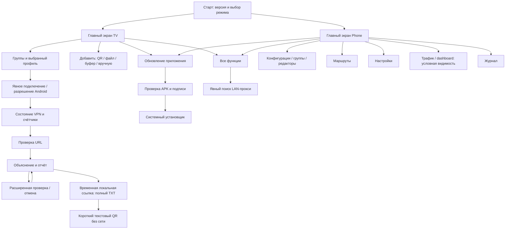

# Атлас интерфейса TunXBox и программа UX-аудита

## Краткий вывод

База аудита: `bfde4b48fea30684090272be83f7e0b58af04d0c`, ветка диагностики поверх release candidate; не stable 1.5.0 и не только установленный rc158. Это **структурный аудит и рабочая спецификация**, не заявление «все экраны визуально проверены». Последующие изменения требуют повторной генерации реестра и приёмки.

Сильная сторона продукта — один профильный клиент с отдельными TV/Phone интерфейсами, явным выбором подключения, локальным обменом и безопасной диагностикой. Главный дизайнерский риск — не цвет или скругления, а плотность возможностей: пользователь должен без технической подготовки различать выбранный профиль, действующее соединение, последнюю проверку и доступность Интернета. Рекомендуется эволюционное улучшение, не полная перерисовка и не удаление функций.

## Как пользоваться картой

1. [Реестр элементов](reference/ui/elements.md): XML-узлы и программные места создания, включая элементы отображения, поля, контейнеры, меню и preferences.
2. [Машиночитаемые элементы](reference/ui/elements.json): стабильный адрес source+ordinal, ID/key, исходные ограничения, EN/RU и флаги риска.
3. [Граф переходов и связей](reference/ui/transitions.json): отделены заданные/прослеженные связи от найденных в коде кандидатов.
4. [Граф DOT](reference/ui/navigation.dot): открывается Graphviz; не выдаётся за скриншот приложения.
5. [Границы покрытия](reference/ui/coverage.json): точные объёмы и отсутствие полной runtime/visual приёмки.
6. [Все настройки по ключам](reference/preferences.md), [существующая спецификация TV-переходов](reference/tv-navigation.json), [диагностика](diagnostics-ux-review.md).

`SOURCE_ONLY` означает «найдено в исходниках», **не** «работает правильно». Место создания в цикле не равно одной кнопке. XML-контейнер не равен пользовательскому действию. Условная видимость, flavors, plugin/editor динамика и вложенный WebView требуют отдельной трассировки. Счётчики нельзя представлять как число проверенных элементов.

## Понятная обзорная схема

Это обзор задач, не подмена полного обработчиками ориентированного графа JSON. Обратные переходы, системные разрешения, отмена, внешние приложения и восстановление фокуса проверяются отдельными сценариями ниже.

## Контракт каждого элемента

При завершении ручного аудита для элемента заполняются: source/ID; экран/состояние; назначение; входные данные; действие/побочный эффект; включённость/видимость и причина; результат/ошибка/отмена; Back; D-pad/клавиатура/touch/mouse; accessible name/role/state; RU/EN; доступ к полному тексту; доказательство (SHA, APK, устройство, скриншот, тест); severity, исправление и retest. Не заполнять неизвестные поля предположениями.

## Дизайнерский разбор и реестр замечаний

Оценка опирается на visibility of system status, recognition rather than recall, error prevention/recovery, progressive disclosure, consistent navigation; Material/Android TV и WCAG используются как критерии, не как неподтверждённая сертификация или мнение конкретного дизайнера.

| ID / приоритет | Наблюдение по исходникам | Риск / решение | Статус доказательства |
|---|---|---|---|
| UX-01 / P1 | `ActionPresenter`: title 20sp/2 строки, subtitle 16sp/3 строки, END ellipsis; ширина по TvLayoutPolicy | Длинные RU/EN команды и large font могут терять смысл. Основной глагол в начале; детали — в доступной полной карточке/окне. Нельзя просто уменьшать шрифт | Код подтверждён; обрезание конкретной строки не доказано без рендера |
| UX-02 / P1 | `ConnectionCardPresenter`: имя 2 строки, bytes/result по 1 строке с ellipsis | Длинное имя и результат проверки конкурируют с читаемостью. Сохранить раздельные строки и полный отчёт; проверить 360dp и 200% font, не урезать диагностику | Структура подтверждена; матрица вместимости открыта |
| UX-03 / P1 | `DiagnosticShareDialog`: QR до 220dp, фиксированная доступная высота, локализованная инструкция, две нижние кнопки | Плотный текстовый QR и длинные подписи требуют проверки 720p/large font, дистанции и камеры. При необходимости fullscreen QR с отдельными инструкциями, без уменьшения QR | Требуется физическая приёмка; bitmap decode не заменяет камеру |
| UX-04 / P1 | Успех URL, состояние сервиса, выбранный/активный профиль и counters — разные сущности | Не использовать общий зелёный «всё работает». Последняя проверка с временем; selected/active должны быть различимы текстом, не только цветом | Улучшено в PR17; всех состояний визуально не принято |
| UX-05 / P1 | Source-реестр отмечает fixed heights, maxLines, missing static labels | Это кандидаты на проверку, не автоматические дефекты: label может назначаться в binding, высота может быть корректна | Каждый флаг требует handler/layout trace и рендера |
| UX-06 / P2 | Phone drawer содержит конфигурации, группы, маршруты, настройки, трафик, LAN, tools, log, FAQ, update, about, lifecycle | Разделить ежедневные задачи, обслуживание и опасные действия; не удалять advanced возможности. Убедиться, что «Все функции» не тупик и возвращает фокус | Меню подтверждено; новая IA пока рекомендация |
| UX-07 / P1 | Updater имеет внешний scroll, отдельный read-only log preview 200dp и явные действия | Большой журнал не должен перехватывать Down между кнопками. Ошибка/подпись/канал доступны до Install; не изображать проверенный APK до проверки | Код и named smoke существуют; новая визуальная матрица открыта |
| UX-08 / P1 | Диагностика хранит whitelist и не включает raw secret/error strings | Не добавлять приватный endpoint в UI/report ради «подробности». Объяснение + next action перед enum; полные данные профиля не просить для публичного issue | Source подтверждён; regression tests обязательны |
| UX-09 / P2 | Разные формы карточек и меню имеют разную плотность информации | Один язык: короткий заголовок-действие, статус, вторичная строка; primary/secondary/danger не только цветом; системные dialog conventions сохранить | Дизайн-направление, не внесённая визуальная правка |

P0: потеря данных/секреты/неожиданное подключение или обход подписи — блокирует релиз. P1: недоступно основное действие, focus trap, скрытая ошибка, нечитабельный смысл — блокирует затронутый путь. P2: согласованность и эффективность. P3: косметика. Наличие открытого P2/P3 не требует искусственного закрытия issue ради stable.

## Матрица состояний и приёмки

Для **каждого** экрана/элемента проверить normal, empty, loading, success, recoverable error, offline, permission denied, disabled/busy, cancel, background/resume и изменившийся профиль/сеть; неприменимые состояния помечать N/A с причиной.

- Phone: 360/390dp portrait и landscape; TV: 720p/1080p; RU/EN; font scale 1.0/1.3/2.0; длинное имя/IPv6/крупные счётчики; theme variants, если реально поддержаны.
- Вместимость: Android Layout/getEllipsisCount и фактические bounds, а не число символов. Скриншот на каждом заявленном размере. Критическая команда/ошибка не теряет смысл; полный текст достижим; horizontal overflow отсутствует.
- Управление: cold-start focus, все четыре стрелки, Enter/Back, повторное открытие/возврат из Android installer, rotation/resume; touch drag/mouse wheel не вызывают snap-back; изменяемая строка не крадёт фокус.
- Доступность: TalkBack name/role/state, meaningful order, focus indicator, не только цвет; touch target обычно не менее 48dp для Android; contrast AA 4.5:1 normal text, 3:1 large text/meaningful boundaries. Измерить реальные rendered пары, не объявлять по палитре.
- Безопасность: тест/отмена/выбор группы не меняют VPN неожиданно; destructive actions с подтверждением; listener закрыт на Back/background/expiry/network; installer только после проверки APK.
- Доказательства хранить с SHA, flavor, API/page size, locale, density/fontScale, сценарием, screenshot и pass/fail. Непосмотренный снимок не является visual PASS.

## Продолжение разработки

Последний запрос диагностики не требует доказательства старой Hysteria2/TLS неисправности: наблюдение продолжается. CI последнего кода `bfde4b48` завершился success: Source/F-Droid `39597943443`, Verified Stable `39597943699`. Это результаты workflow, не публикация APK, не всеобщий UI PASS и не физическая проверка QR. Перед merge PR17 нужны проверка exact-source результатов и фактических screenshots. PR12/master/stable не изменять только из-за зелёных сборок.

Очередность: (1) принять диагностический путь и QR; (2) завершить handler trace всех source candidates; (3) параметризованные screenshot/text-fit тесты для P1; (4) исправлять подтверждённые дефекты малыми PR с retest; (5) визуальная унификация P2 без потери функций; (6) релизные/F-Droid/signing gates отдельно. Это честная программа полного аудита: структурное покрытие создано, ручная проверка каждой динамической ветви и каждого пиксельного состояния ещё не завершена.

## Воспроизводимость

`python3 buildScript/build_ui_atlas.py` обновляет карту; `--check` проверяет drift. Затем `python3 buildScript/check_project_docs.py --update-index` и повторная проверка ссылок. Генератор не читает пользовательские конфиги, ключи, сетевые адреса или build artifacts. При изменении элементов/handlers обновить карту и матрицу доказательств в том же PR.
