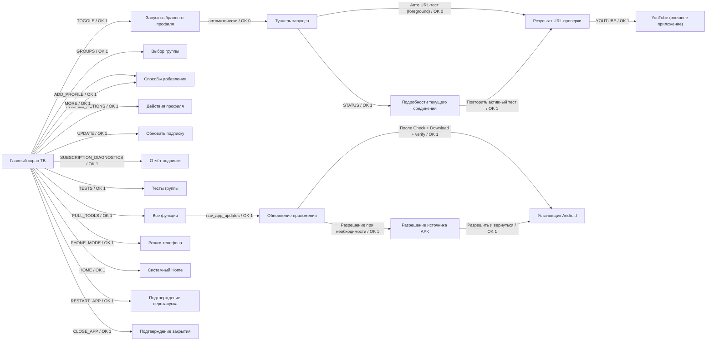

# Граф навигации ТВ — source-linked

Сгенерировано из [машиночитаемого графа](reference/tv-navigation.json). Это переходы и OK-подтверждения, не скрытая телеметрия. Направления D-pad и реальная длительность измеряются отдельно на устройстве. При изменении action/menu IDs CI требует обновить граф.

## Основной путь

Раньше для явной проверки перед YouTube: подключиться → открыть статус → запустить тест → открыть YouTube: **4 OK**, плюс перемещения/первое согласие Android. Новый кандидат: подключиться → автоматический результат → YouTube: **2 OK**. Это модель подтверждений при уже выбранном профиле, не доказательство всех физических D-pad путей. Ошибка не открывает обязательный modal и не крадёт фокус.

## D-pad и порядок

- Верхний ряд: подключение → группы → добавить → Phone; начальный фокус и стабильные IDs сохранены.
- Следующий ряд: компактный статус/результат → YouTube (когда сервис запущен). Из Connect: Down к статусу, Right к YouTube при исходной колонке 0. Проверить на 720p/1080p, больших шрифтах и после обновления данных.
- Профили: отдельный ряд; число карточек и положения динамические, не выдавать условный shortest path за реальные расходы всех пользователей.
- Инструменты: текущие 9 действий пока сохраняются; граф показывает дубль MORE/ADD и длинный горизонтальный путь к редким операциям.

## Следующая оптимизация (не реализована этим графом)

Собрать редкие Home/restart/close и отчёты в один список «Ещё», убрать дубли импорта без потери методов, дать updater прямой путь. Сравнить частые и редкие сценарии: OK, D-pad, диалоги, возврат Back, focus stability, error recovery. Не уменьшать клики удаления ценой подтверждения и не скрывать ошибки. Все функции полного [каталога](features.md) должны оставаться достижимы.

## Критерии регулярного review

После каждого UI PR обновлять JSON/граф, CI coverage/confirmation budget и реальные скриншоты/DPAD smoke. Проверять выбранный/активный профиль, offline/failure/no profiles, смену сети, отмену, YouTube return, installer return. Граф не утверждает готовность runtime функций до CI и device acceptance.
